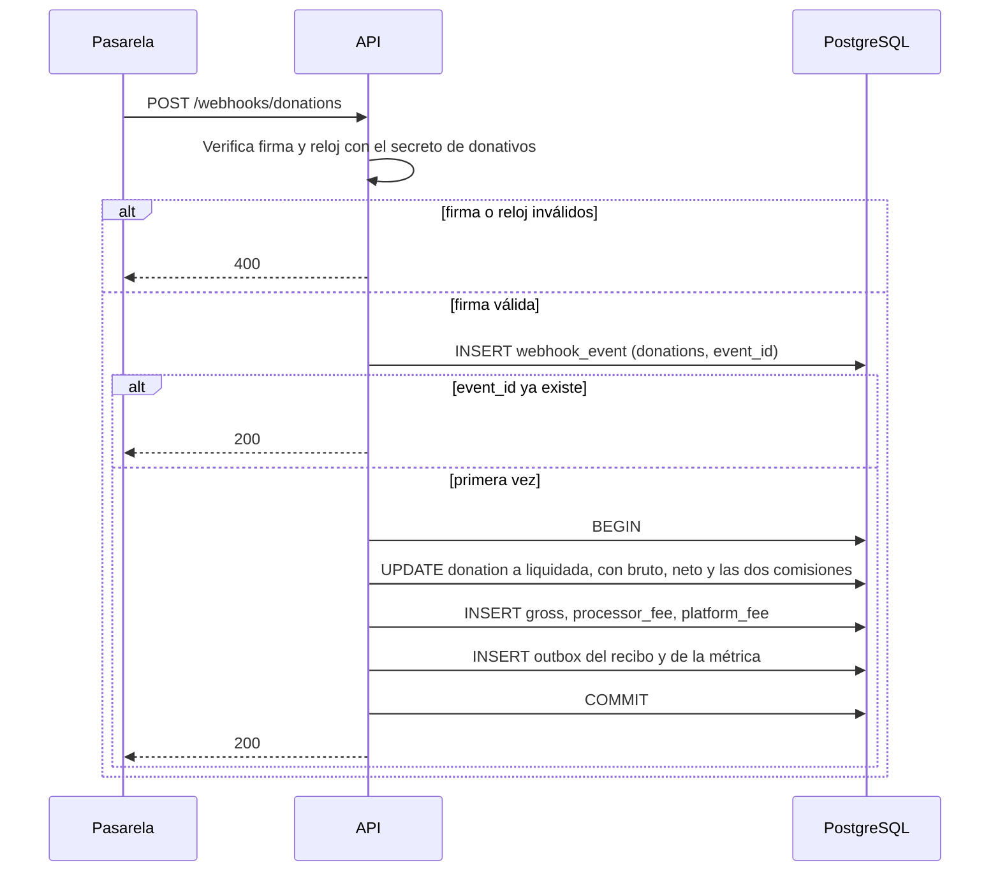
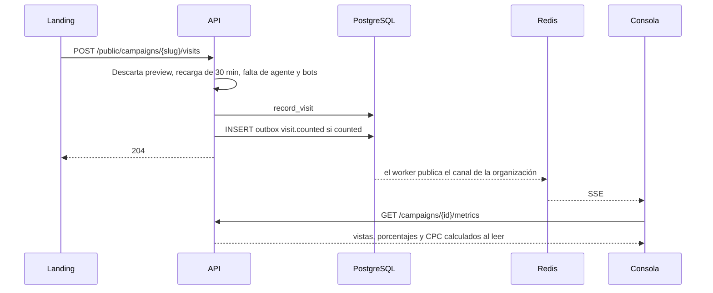
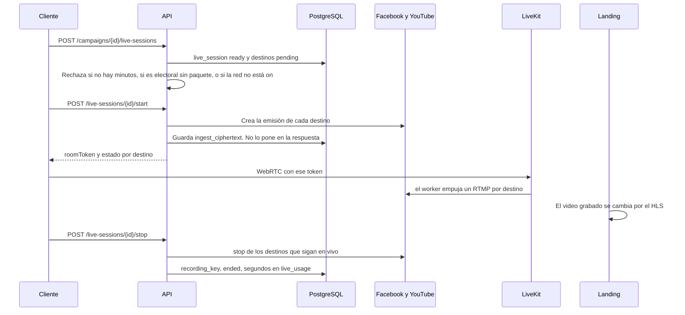

# Diseño detallado

Octubre 2026. Baja los casos de `analisis-sistema-campanas.md` a tres artefactos:

| Artefacto | Archivo |
| --- | --- |
| Casos CU-19, CU-20, CU-21, CU-22 y CU-23 | `analisis-sistema-campanas.md`, sección 2 |
| Modelo físico | `campanas-esquema.sql` |
| Contrato HTTP | `campanas-openapi.yaml` |

La arquitectura sigue mandando en la forma del sistema. Este documento manda en el orden de las llamadas y en qué tabla escribe cada paso.

La tabla de personas se llama `app_user`. El análisis la llama user. En PostgreSQL ese nombre es reservado.

La consola conecta como `app_api`, sujeta a RLS, con `app.user_id` puesto en la sesión. El webhook, el pixel, el libro y el worker de live conectan como `app_worker`, que salta la RLS. Los triggers de solo inserción les aplican igual.

## 1. Qué caso escribe qué

| Caso | Tablas | Operación HTTP |
| --- | --- | --- |
| CU-01, CU-18, CU-02, CU-16 | `app_user`, `email_token`, `session`, `mfa_secret`, `external_identity`, `oauth_transaction` | `POST /auth/register`, `/auth/verify`, `/auth/login`, `/auth/oauth/{provider}/start`, `/callback`, `/link`, `/auth/step-up` |
| Organización del owner | `organization`, `membership`, `subscription` sobre el plan `fundador` | `POST /organizations` |
| CU-05, CU-23 | `campaign.slug`, `campaign.store_url` | `POST /campaigns`, `PATCH /campaigns/{id}` |
| CU-21 | `privacy_notice` en borrador; al publicar, también `donation_page` si la campaña no es comercial y el plan tiene donativos | `POST /campaigns/{id}/privacy-notices`, `POST /campaigns/{id}/privacy-notices/{noticeId}/publish` |
| CU-09, CU-14 | `donation` con `privacy_notice_id` | `POST /public/campaigns/{slug}/donations` |
| CU-15 | `webhook_event`, `donation`, tres filas en `campaign_ledger_entry`, `outbox_event` | `POST /webhooks/donations` |
| CU-20 | `invoice.cfdi_uuid`, `outbox_event` | `POST /webhooks/billing` y el worker del PAC |
| Visita y tablero | `visit_event`, `metric_bucket` | `POST /public/campaigns/{slug}/visits`, `GET /campaigns/{id}/metrics`, SSE |
| CU-19 | `live_session`, `live_destination`, `live_usage` | `POST /campaigns/{id}/live-sessions`, `/start`, `/stop` |
| CU-22 | `donation.donor_name`, `donor_email`, `anonymized_at` | `POST /donations/{id}/rights` |

Un cupo NULL en el plan `campana` quiere decir que el análisis no fijó ese tope. El plan `fundador` trae los topes escritos: 1 campaña, 2 conexiones, 0 minutos de live. El plan `campana` incluye 60 minutos de live al mes. El live se construye después de esa historia. Una dispersión por encima de 100000 unidades menores de USD, o en otra moneda, pide un segundo owner.

## 2. Secuencia del webhook que asienta

CU-15. El cliente ya creó la donación pendiente. Esta secuencia no calcula el monto desde el cuerpo del webhook: lo compara con la fila.

La respuesta sale después del commit. Si `gross_minor` no es `net_minor + processor_fee_minor + platform_fee_minor`, el `CHECK` de `donation` aborta la transacción, no queda asiento y esa campaña no se dispersa.

`campaign_ledger_entry` rechaza UPDATE y DELETE. Un reembolso o una disputa insertan otra fila. El recibo que arma el outbox dice que no es un comprobante fiscal deducible.

El webhook de billing usa el otro secreto y la otra ruta. Ahí no se escribe el libro de campaña. Si la factura queda pagada, el outbox dispara CU-20. El worker del PAC timbra una vez por `invoice.id` y guarda `cfdi_uuid`.

## 3. Secuencia de la visita que llega al tablero

El beacon solo se envía si CU-21 dejó una versión publicada. La carga del landing manda `view`. El clic en Donar manda `click`. La API clasifica. `record_visit` inserta el evento, con su tipo, y, si cuenta, suma el cubo de ese tipo, en la misma llamada.

`visit_event` no tiene columna de dirección de red. El código postal se calcula y la IP se tira. Los porcentajes no se guardan. El CPC sale del `ad_spend` del periodo y solo para owner y admin. Si no hay gasto, el campo va vacío.

Si el SSE se corta, la consola vuelve a llamar a `GET /metrics`. La web y la tableta usan la misma ruta.

## 4. Secuencia del live

CU-19. Un origen. Una fila `live_destination` por red. Facebook Página y YouTube son los conectores encendidos en `network_catalog.live_mode = 'on'`.

Si YouTube rechaza y Facebook acepta, `live_destination` de YouTube queda en `failed` y Facebook sigue en `live`. El aviso usa el mismo canal que una publicación fallida.

Repetir `start` sobre una sesión ya en vivo responde 409 y no abre otra emisión. Si el origen cae, el worker espera 30 segundos y luego manda stop. A las cuatro horas detiene la sala aunque nadie pulse el botón.

La llave RTMP vive en `ingest_ciphertext`. No viaja en el JSON de `LiveSession` ni en el log.

Cerrar la campaña (CU-11) llama a este stop si la sesión sigue en vivo.

## 5. Reglas que el esquema ya no deja al código

| Regla del análisis | Dónde quedó |
| --- | --- |
| Montos en unidades menores y moneda | `bigint` y `char(3)` |
| Bruto = neto + las dos comisiones | `CHECK` de `donation` |
| Libro, donación, intentos, visitas, webhooks y auditoría no se borran | Triggers `reject_delete` y `reject_update` |
| El dato del donante sí puede corregirse o vaciarse | `donation_update_guard`. Los montos y `privacy_notice_id` no |
| Una versión publicada por campaña | Índice único parcial de `privacy_notice` |
| La campaña comercial no abre página de donación | Trigger de `donation_page` |
| El enlace de tienda es https | `CHECK` de `campaign.store_url` |
| El electoral sin paquete no sale de borrador | `CHECK` de `campaign` |
| El slug queda fijo al publicar el aviso | Trigger `campaign_slug_lock` |
| Una vista y un clic se distinguen | `visit_event.event_type` |
| El subject del proveedor no se repite | `UNIQUE (provider, subject)` de `external_identity` |
| Un owner por organización | Índice único parcial de `membership` |
| Un event_id por proveedor | `UNIQUE (provider, event_id)` |
| Un CFDI por factura | Índice único de `invoice.cfdi_uuid` |
| Periodo de gasto cerrado no se edita | `ad_spend_update_guard` |
| Cada organización ve lo suyo | RLS forzada. El rol se vuelve a leer en `membership` |

## 6. Cómo se prueba este diseño

1. Aplicar `campanas-esquema.sql` en PostgreSQL 16 vacío.
2. Generar el paquete TypeScript desde `campanas-openapi.yaml` y compilar la web y la tableta contra ese paquete.
3. Del webhook: el mismo `event_id` dos veces deja tres asientos, no seis. Un bruto que no cuadra deja cero asientos.
4. De la visita: una vista previa queda en `counted = false` y no mueve el cubo. Una carga contada suma `view` y un clic en Donar suma `click`. Una visita contada aparece en `GET /metrics` sin recargar a mano.
5. Del live: un destino fallido deja el otro en `live`. La respuesta de `start` no contiene la llave RTMP.
